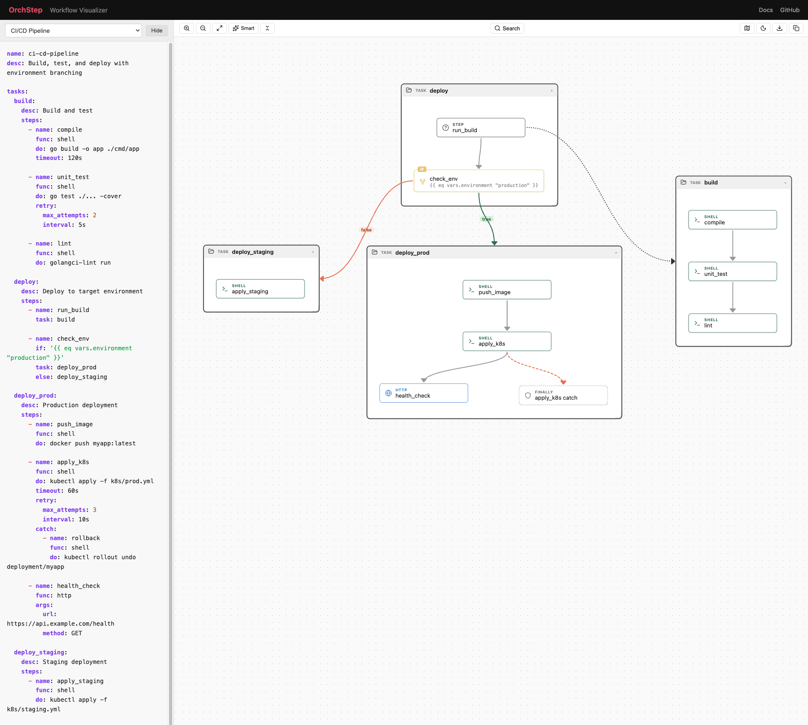
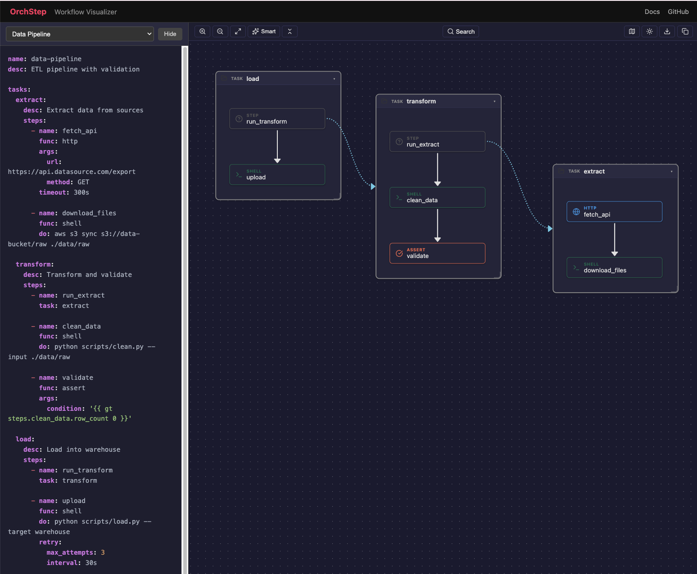

<p align="center">
  <picture>
    <source media="(prefers-color-scheme: dark)" srcset="docs/images/logo-dark.png">
    
  </picture>
</p>

# OrchStep


 

**Automate everything — built for developers and AI agents.** Run anywhere as a single binary, no vendor lock-in.

> **⚡ Describe it. Get automation.** Install the
> [`orchstep-workflow-design`](skills/orchstep-workflow-design/) skill, answer a
> few questions from a built-in [prompt generator](#-try-it-right-in-this-repo)
> (`orchstep run prompt_migrate`), and paste the result into your AI agent — it
> builds your OrchStep workflow **from the codebase you already have**, or
> migrates your existing Makefile / Justfile / Taskfile / Gradle build / shell
> scripts / CI pipeline for you. Generated once — replayed forever, zero tokens.

## 🚀 Setup — 1, 2, 3

```bash
# 1. Install OrchStep
curl -fsSL https://orchstep.dev/install.sh | sh   # verifies the release SHA-256 checksum
#    or: brew tap orchstep/tap && brew install orchstep · npm install -g orchstep · pip install orchstep

# 2. Grab this repo — it ships runnable demos
git clone https://github.com/orchstep/orchstep.git && cd orchstep

# 3. The must-see demo — interactive task menu
orchstep menu

# 4. The GUI — run tasks from a local web dashboard
orchstep serve        # -> http://127.0.0.1:7777   (or pick "dashboard" in the menu)
```

More install options: [Distribution](#distribution) below · full guide: [installation docs](https://orchstep.dev/getting-started/installation) on orchstep.dev.

📖 **Docs & live demos:** [orchstep.dev](https://www.orchstep.dev/)

OrchStep runs multi-step workflows for developers and AI agents. It delegates to your existing tools (terraform, kubectl, aws, docker) rather than reimplementing them.

### CI/CD Pipeline — with YAML editor and syntax highlighting



### Data Pipeline — dark mode with Smart layout



> **[Try the live Workflow Visualizer →](https://orchstep.dev/visualize)** Paste any OrchStep YAML to see it as an interactive diagram.
>
> The `@orchstep/workflow-viewer` package powers the visualizer — an interactive React component that renders OrchStep workflows as directed graphs. Features include Smart/Vertical/Horizontal layouts, dark mode, collapsible tasks, search, export to PNG, and copy to clipboard. Available at [`packages/workflow-viewer`](packages/workflow-viewer).

## 🎬 Capture agent work → replay with zero tokens

When an AI coding agent (Claude Code, Cursor, …) solves a real task for you —
running a test suite, a deploy, a multi-step shell sequence — that reasoning
costs tokens **every single time you run it**. With OrchStep you capture the
solved session **once** into a replayable `orchstep.yml`. Every run after that
executes the *same business logic* deterministically — **no LLM, no tokens, no
drift.**

For repeated testing and operational work that's **up to ~80% less agent token
spend**: the first run pays for the reasoning; every run after is just
`orchstep run`.


```bash
# In Claude Code, right after the agent finishes the task:
/orchstep-capture                       # compress the session into orchstep.yml

# Forever after — same result, no model in the loop:
orchstep run -f captured.orchstep.yml
```

> Record your test steps or shell scripts as a workflow once, and re-running the
> same logic never touches an LLM again. The [`orchstep-capture`](skills/orchstep-capture/)
> skill turns "the agent already did this once" into a permanent, shareable,
> deterministic workflow.

### 🧠 Design workflows with your agent

The [`orchstep-workflow-design`](skills/orchstep-workflow-design/) skill teaches
Claude (and any MCP-capable agent) to author **production-grade** OrchStep YAML —
real failure handling, not just the happy path. It ships dense references,
annotated examples, and a guided wizard:

- **Quick mode** — give a concrete task, get a correct workflow, no questions.
- **Wizard mode** — "help me design this" → 2–4 intent questions → a tailored workflow.

**Claude Code — one command** (installs all OrchStep skills + the MCP server as a plugin):

```text
/plugin install orchstep --marketplace orchstep/orchstep
```

Or from a terminal: `claude plugin marketplace add orchstep/orchstep && claude plugin install orchstep@orchstep`.

**Any other agent: one command.** The skills use the open [Agent Skills](https://agentskills.io) `SKILL.md` format, and the [`skills`](https://github.com/vercel-labs/skills) installer puts them where your agent looks (Codex, Cursor, GitHub Copilot, Gemini CLI, Kimi Code, OpenCode, Cline, Windsurf, Amp, Goose, Qwen Code and about 70 more):

```bash
npx skills add orchstep/orchstep          # pick agents interactively; add -g for user-wide
npx skills add orchstep/orchstep -a codex -a cursor -a kimi-code-cli -y
```

No Node? Copy the `skills/` folders into `.agents/skills/` in your project: most agents read that shared directory. Then connect the MCP server (`orchstep mcp serve`) so the agent can list, preview and run workflows as tools. Per-agent config is in [`skills/orchstep-mcp-integration`](skills/orchstep-mcp-integration/SKILL.md#mcp-client-configuration).

| Agent | Skills | MCP | Status |
| --- | --- | --- | --- |
| Claude Code | plugin | plugin | tested |
| Kimi Code CLI (with Kimi K3 and DeepSeek V4 models) | `.agents/skills` | `.kimi-code/mcp.json` | tested 2026-11 |
| OpenCode (with a DeepSeek model) | `.agents/skills` | `opencode.json` | tested 2026-11 |
| Codex | `.agents/skills` | `codex mcp add` | skills confirmed by a user report; [MCP + CLI: help verify](https://github.com/orchstep/orchstep/issues/22) |
| Cursor, GitHub Copilot, Gemini CLI, Windsurf, Cline | `.agents/skills` | standard `mcpServers` config | documented; help verify: [Cursor](https://github.com/orchstep/orchstep/issues/4), [Copilot](https://github.com/orchstep/orchstep/issues/5), [Gemini CLI](https://github.com/orchstep/orchstep/issues/6), [Windsurf](https://github.com/orchstep/orchstep/issues/7), [Cline](https://github.com/orchstep/orchstep/issues/8) |

See [`skills/README.md`](skills/README.md#installing-skills) for details and alternatives.

**Or let OrchStep write the prompt for you.** This repo's built-in prompt generators interview you with select/checkbox/text questions, then emit a ready-to-paste prompt engineered for this skill — CI/CD pipelines, release automation, environment setup, and migrations from Make / Just / Task / Ant / Gradle / shell scripts / GitHub Actions, out of the box:

```bash
orchstep run prompt_migrate    # migrate existing automation (Make, Gradle, CI, scripts) to OrchStep
orchstep run prompt_features   # design a new workflow from a feature checklist
orchstep run prompt_scenario   # common scenarios: env setup, CI/CD, release, runbooks, data pipelines
```

Paste the generated prompt into Claude Code (or any agent with the skill installed) and it designs the workflow for you — from your actual codebase, with error handling and assertions included:


## 🚀 Try it right in this repo

The repo root ships an [`orchstep.yml`](orchstep.yml) so a fresh clone gives you something to run immediately — `orchstep menu` opens the picker, or run any task directly:

> **Interactive picker:** Run `orchstep menu` in any directory with an `orchstep.yml` to open a keyboard-driven task picker. Single-keystroke hotkeys, fuzzy search (arrow keys or `/`), and a filter cycle (`f` to cycle all → a-z → public → internal). Running plain `orchstep` in a terminal also auto-launches the menu; in a pipeline it exits cleanly instead of hanging.

| Task | What it shows |
|------|---------------|
| `orchstep run demo` | All demos in sequence: hello world, HTTP GET, HTTP POST |
| `orchstep run hello --var greet_name=you` | Variable substitution from the CLI |
| `orchstep run http_get` / `http_post` | Templated HTTP calls with retries and status assertions |
| `orchstep run dashboard` | The local web GUI (`orchstep serve`) — run tasks from a browser, watch live output |
| `orchstep run prompt_migrate` | Interview → prompt: migrate a Makefile / Justfile / Taskfile / Ant / Gradle / shell scripts / GitHub Actions to OrchStep |
| `orchstep run prompt_features` | Checkbox feature picker (env groups, dotenv, retries, parallel, …) → prompt to design a new workflow |
| `orchstep run prompt_scenario` | Common scenarios (dev env setup, CI/CD, release automation, ops runbooks, data pipelines) → prompt |
| `orchstep run install_skill` | Install the workflow-design skill into Claude Code |
| `orchstep run upgrade` | Upgrade the OrchStep binary via the official installer |
| `orchstep run todos` | Planned additions + how to contribute |

The `prompt_*` tasks are OrchStep dogfooding itself: the engine interviews you with select/checkbox/text prompts, then prints a copy-paste prompt engineered for the [`orchstep-workflow-design`](skills/orchstep-workflow-design/) skill. Paste it into any agent that has the skill installed and it writes the workflow — from your actual codebase, with error handling and assertions included. More classic examples live in [`demos/`](demos/).

## 🎬 OrchStep CLI — 90-second tour

`run` with live logs, `menu`, `--dry-run` preview, environments, JSON for CI/agents, and **capture → replay** (zero tokens) — the whole CLI in a minute and a half.

[](https://youtu.be/f8p4Gz6XUo8)

▶ **[Watch the 90-second tour](https://youtu.be/f8p4Gz6XUo8)**

## 🖥️ OrchStep Pipeline — a web dashboard for the CLI

The command line is the product. `orchstep run`, `orchstep menu`, `orchstep mcp` — that's the first-class interface: scriptable, CI-friendly, agent-friendly, no browser required.

**OrchStep Pipeline** is the *optional* companion to it — a second-class citizen by design. It's a local web dashboard you open with a single command when you'd rather click, watch, and inspect. Everything it does is an `orchstep` command underneath, and it prints the exact CLI invocation for every run, so nothing you do in the browser is locked to the browser.

```bash
orchstep serve     # -> http://127.0.0.1:7777  (one static binary, nothing else to set up)
```

Pick a task and read it as source, a resolved plan, or the full execution graph; launch it with an environment and pretty logs; watch every step light up live as the run descends into each called task; jump from a step straight to its logs; and inspect exactly what any step saw — its variables, environment, and output. Run history lives in a single SQLite file, it binds to `127.0.0.1`, and there's no infra or signup.

[](https://youtu.be/4xZm_ZmSC_g)

▶ **[Watch the 60-second tour](https://youtu.be/4xZm_ZmSC_g)** · full walkthrough at [orchstep.dev/learn/serve](https://orchstep.dev/learn/serve)

## What's in This Repo

| Directory | Contents |
|-----------|----------|
| `spec/` | OrchStep YAML language specification |
| `modules/` | Official and community module registry |
| `skills/` | LLM agent skill documents |
| `mcp/` | MCP server interface specification |
| `demos/` | Example workflows for real-world use cases |
| `docs/` | User documentation |

## Quality & Testing

The OrchStep engine is rigorously tested with a comprehensive regression suite:

| Metric | Value |
|--------|-------|
| Regression test cases | **545** across 182 spec directories |
| Pass rate | **100%** (545/545) |
| Feature categories tested | **14** (execution, variables, control flow, loops, error handling, HTTP, git, templates, environment, config, assertions, modules, data flow, advanced) |
| Platforms verified | **6** (darwin/amd64, darwin/arm64, linux/amd64, linux/arm64, windows/amd64, windows/arm64) |
| CI pipeline | Build, lint, vet and unit tests on every engine change; full regression suite on a weekly schedule and before every release |

Every release is gated by the full regression suite. The test infrastructure includes mock HTTP servers, mock CLI simulators, and authenticated git operation tests to ensure real-world reliability.

### What's Tested

- **Workflow execution** — task pipelines, step sequencing, shell command execution
- **Variable management** — 4-level scoping, precedence, dynamic resolution, type preservation
- **Control flow** — if/elif/else, switch/case, loops (items/count/range/until), task delegation
- **Error handling** — retry with exponential backoff + jitter, try/catch/finally, timeouts, on-error modes
- **HTTP integration** — GET/POST/PUT/DELETE, authentication (bearer/basic/API key), JSON parsing, batch requests
- **Git operations** — clone, checkout, push, fetch, branches, tags, submodules, authenticated operations
- **User prompts** — text, password, select, confirm, multiselect with non-interactive mode for CI/agents
- **Module system** — config schemas, exports, versioning, dependencies, nesting, remote git modules, lockfiles
- **Templates** — Go templates, Sprig functions, JavaScript expressions, regex extraction
- **Environment** — .env file loading, inheritance modes, groups, hierarchical configs

## The Engine

The OrchStep engine is distributed as a compiled binary. Install it using any method above, then use the spec and modules in this repo to build workflows.

## Distribution

| Channel | Install Command |
|---------|----------------|
| **curl** | `curl -fsSL https://orchstep.dev/install.sh \| sh` |
| **Homebrew** | `brew tap orchstep/tap && brew install orchstep` |
| **npm** | `npm install -g orchstep` |
| **pip** | `pip install orchstep` |
| **Docker** | `docker pull orchstep/orchstep:latest` |
| **GitHub Action** | `uses: orchstep/setup-orchstep@v1` (install) / `uses: orchstep/run-orchstep@v1` (one-step run) |

All channels pull binaries from [GitHub Releases](https://github.com/orchstep/orchstep/releases).

| Directory | Contents |
|-----------|----------|
| `homebrew/` | Homebrew formula (auto-updated by GoReleaser) |
| `npm/` | npm wrapper package |
| `pip/` | pip wrapper package |
| `docker/` | Docker image configuration |
| `action/` | GitHub Action for CI/CD |

## For LLM Agents

OrchStep is designed for AI agent integration:

- **CLI:** `orchstep run task --output json` for structured output
- **MCP Server:** `orchstep mcp serve` for native tool_call integration (bundled in the Claude Code plugin)
- **Skills:** Install skill documents from `skills/` to teach agents OrchStep patterns — including [`orchstep-capture`](skills/orchstep-capture/) (turn a solved session into a replayable, zero-token workflow) and [`orchstep-workflow-design`](skills/orchstep-workflow-design/) (author production-grade workflows)
- **Prompts:** Interactive input for humans, auto-skipped for CI/agents with `ORCHSTEP_NON_INTERACTIVE=true`

## Cross-Platform

OrchStep runs on Linux, macOS, and Windows:

- **Default shell:** POSIX `sh` — works on Alpine, distroless, all Linux/macOS
- **Go-native shell:** Set `type: "gosh"` for Windows support without bash
- **Explicit shells:** `bash`, `zsh`, `pwsh` available as opt-in

## Module Registry

OrchStep has a tiered module ecosystem:

- `@orchstep/*` — Official modules maintained by the OrchStep team
- `@community/*` — Verified community contributions
- `@ai/*` — LLM-generated modules (auto-validated)

Browse available modules in the `modules/` directory or search with:
```bash
orchstep module search deploy
```

<p align="center">
  <a href="https://orchstep.dev">
    
  </a>
</p>

## Contributing

We welcome module contributions from humans and AI agents! See [CONTRIBUTING.md](CONTRIBUTING.md).

## License

- **The OrchStep engine binary is free for individual and commercial use** under the one-page [OrchStep Binary License](EULA.md) (also at [orchstep.dev/license](https://orchstep.dev/license)).
- **Open content in this repo** (spec, modules, skills, demos, docs) is licensed under [Apache 2.0](LICENSE).
